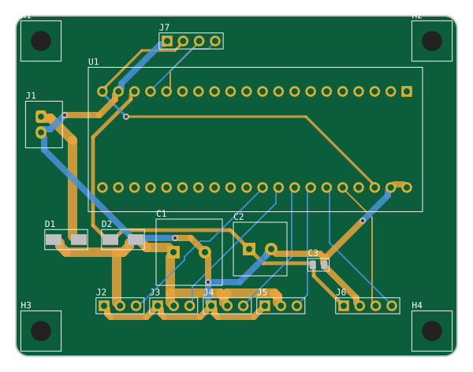

# 曼波机器狗（Manbo Robot Dog）

> 基于 STM32F103C8T6 的低成本桌面四足机器狗：**说口令就走，还会回话、做表情**。精简版整机约 50–75 元（4 个 SG90 舵机 + SU-03T 离线语音 + OLED + 4 节 5 号电池）；完整版另有蓝牙、超声波避障、红外防跌落、电池检测。

**维护者：[@1708018656-ship-it](https://github.com/1708018656-ship-it)** · 基于 [RussellCooper-DJZ/manbo-robot-dog](https://github.com/RussellCooper-DJZ/manbo-robot-dog)（MIT）

[](.github/workflows/ci.yml)
[](LICENSE)
[](https://www.st.com/en/microcontrollers-microprocessors/stm32f103c8.html)

本仓库是在原项目基础上的**整体优化版**：修了一批真实 bug，固件全面非阻塞化，新增看门狗、电池检测和舵机校准，并从零设计了一块可直接下单的**扩展底板 V2**。逐条改动见 [OPTIMIZATION_PLAN.md](OPTIMIZATION_PLAN.md)。

## 两种版本

| | 精简版（推荐入门，省钱） | 完整版 |
|---|---|---|
| 功能 | 语音口令控制 + 运动 + 语音回复 + OLED 表情 | 以上全部 + 蓝牙 + 超声波避障 + 红外防跌落 + 电池检测 |
| 硬件 | [hardware/lite/](hardware/lite/README.md)：70×54 mm 小板，4 节 5 号电池，SU-03T 语音模块（自带喇叭回话），OLED | [hardware/](hardware/README.md)：100×90 mm 扩展底板 V2，2S 锂电 |
| 固件 | `make LITE=1` | `make V2=1`（或原版飞线 `make`） |
| 大概成本（不含电池、下载器） | 约 50–75 元 | 明显更高（多了语音合成、蓝牙、屏幕、传感器和锂电供电） |

<p align="center"><br><sub>精简版底板（70 × 54 mm，13 个元件）。完整版底板见 <a href="hardware/README.md">hardware/</a></sub></p>

## 这一版改了什么

**修复的 bug（都有对应测试或验证）**
- 超声波避障基本测不到 170 cm 内的障碍物（10 ms 轮询漏掉短回波）→ 直接读中断累计的回波宽度
- 主循环命令分发顺序错误，非阻塞状态机被绕过、每个动作执行两遍
- 高级动作语音变成念拼音字母；长语音被截断且会切坏半个汉字
- 体力为 0 时命令被重放；体力 / 开心值只显示 2 位；语音模块与主控命令编码不一致
- `Time` 变量 volatile 不一致、`speed==0` 除零、`commands.h` 缺头文件、ASR `__dso_handle` 重复定义

**固件改进**
- 主循环里不再有秒级延时：动作、语音、状态播报、红外防跌落、OLED 刷新全部非阻塞
- 独立看门狗（约 1.6 s），急停在任何时候都能立即响应
- 电池电压检测（V2 底板）：低电提醒、过低自动趴下
- 每个舵机可单独微调角度（`Hardware/ServoMath.h` 里的 `SERVO_TRIM_DEG`）
- 全部源码 UTF-8（转换前后二进制逐字节一致），GBK 语音文本用 `\x` 转义
- 新增 GCC 构建（`make`），Keil 工程照常可用；删除死代码后代码段约 22.5 KB / 64 KB

**硬件**：见 [hardware/README.md](hardware/README.md)——双降压分离舵机 / 逻辑供电、防反接、自恢复保险丝、超声波 Echo 分压、红外改到耐 5 V 引脚。

## 快速开始

### 1. 编译固件

| 方式 | 命令 / 操作 |
|---|---|
| Keil MDK 5 | 打开 `Project.uvprojx` 编译。用 V2 底板时在 Options → C/C++ → Define 加 `MANBO_BOARD_V2` |
| GCC | `sudo apt install gcc-arm-none-eabi` 后 `make`（原版接线）、`make V2=1`（V2 底板）或 `make LITE=1`（精简版），产物在 `build/` |
| 烧录 | ST-Link：`make flash`，或 Keil / STM32CubeProgrammer 烧 `build/manbo.hex` |

GitHub Actions 每次推送都会编出三种版本的 `.hex`，可在 Actions 页面直接下载。

### 2. 接线

- **用 V2 底板**：模块直接插，见 [hardware/kicad/pinmap.md](hardware/kicad/pinmap.md)
- **原版飞线**：

| 功能 | 引脚 |
|---|---|
| 舵机 1–4（TIM3 CH1–4） | PA6、PA7、PB0、PB1 |
| 蓝牙 HC-05（USART1） | PA9 → 模块 RXD，PA10 ← 模块 TXD |
| SYN6288（USART2） | PA2 → 模块 RXD，PA3 ← 模块 TXD |
| 语音识别（USART3） | PB10 → 模块 RXD，PB11 ← 模块 TXD |
| OLED（软件 I2C） | PB8 SCL，PB9 SDA |
| HC-SR04 | PA0 Trig，PA1 Echo（**建议加 1k/2k 分压，PA1 不耐 5 V**） |
| 红外 ×4 | 前 PA11、后 PA4、左 PA12、右 PA5（V2：PB12–PB15） |

舵机必须单独供电（5 V ≥ 3 A），不要从 Blue Pill 取电。

### 3. 控制

蓝牙串口助手发单个字符即可，9600 8N1。常用：`f` 前进、`b` 后退、`l`/`r` 转弯、`5` 急停、`d` 跳舞、`o` 打招呼、`p` 趴下睡觉、`Z` 播报状态、`x`/`c` 开关超声波避障、`H`/`h` 开关红外防跌落。完整表格（含体力 / 开心值规则）见 [docs/protocol.md](docs/protocol.md)。

## 仓库结构

```text
User/        应用层：main 主循环、ActionTask 动作状态机、AudioTask 语音、SensorTask 超声波、
             BatteryTask 电池、PetStats 体力/开心值、BoardConfig 板型引脚、Watchdog
Hardware/    驱动：Servo/ServoMath、PWM、OLED、syn6288、Hongwai 红外、UltrasonicWave、Timer
System/      Timebase 1 ms 时基、usart1–3（环形缓冲）、Delay、GbkText
Library/ Start/   ST 标准外设库与 CMSIS（Keil 启动文件）
gcc/         GCC 链接脚本与启动文件；Makefile 在根目录
ASRPro_Code/ ESP32 + ASR PRO 语音识别子项目（PlatformIO）
hardware/    扩展底板 V2：生成脚本、KiCad 工程、BOM、Gerber
tests/host/  主机单元测试（无需开发板）：bash tests/host/run_tests.sh
tools/       编码转换、Cortex-M3 语法检查等脚本
docs/        协议、设计方案、审查报告
```

## 测试

```bash
bash tests/host/run_tests.sh          # 状态机、协议覆盖、GBK 截断、体力规则、电池、超声波、舵机换算
bash tools/check_firmware_syntax.sh   # 用 clang 对 Keil 工程全部 C 文件做 Cortex-M3 检查
python3 hardware/gen/build.py --check # 重新生成底板并跑 ERC/DRC，确认提交的文件是最新的
# CI 另外用 KiCad 8 的 kicad-cli 做官方 ERC/DRC
```

## 文档

| 文档 | 说明 |
|---|---|
| [docs/protocol.md](docs/protocol.md) | 串口命令协议（STM32 与语音模块共用的唯一权威表） |
| [hardware/lite/README.md](hardware/lite/README.md) | **精简版**：底板、供电、组装 |
| [docs/su03t.md](docs/su03t.md) | 精简版 SU-03T 口令配置表 |
| [hardware/README.md](hardware/README.md) | 完整版扩展底板：下单、焊接、上电检查 |
| [hardware/采购清单.md](hardware/采购清单.md) | 整机采购清单（板子、模块、舵机、电池） |
| [OPTIMIZATION_PLAN.md](OPTIMIZATION_PLAN.md) | 本次优化的全部改动与原因 |
| [docs/non_blocking_state_machine.md](docs/non_blocking_state_machine.md) | 非阻塞状态机设计 |
| [ASRPro_Code/README.md](ASRPro_Code/README.md) | 语音识别子项目 |

`docs/` 里 `hardware.md`、`hardware-interface.md`、`gait-control.md`、`software.md`、`code_examples.md` 和两篇论文是早期资料，描述的是 8/12 舵机或 STM32F407 的扩展设想，**与当前代码不一致**，仅供参考。

## 已知限制

- 固件改动已通过主机测试和 Cortex-M3 编译检查，**尚未在实物上回归测试**；如发现动作异常，可用 `git log` 定位并反馈。
- V2 底板是脚本生成并自动布线的，已过 KiCad 8 官方 ERC/DRC，**尚未打样**。
- 4 舵机每条腿只有 1 个自由度，步态以趣味动作为主，不追求真实四足运动学。

## 许可证与致谢

MIT 许可证，见 [LICENSE](LICENSE)。原始项目作者 RussellCooper-DJZ；本版由 [@1708018656-ship-it](https://github.com/1708018656-ship-it) 维护和优化，保留原作者版权声明。
