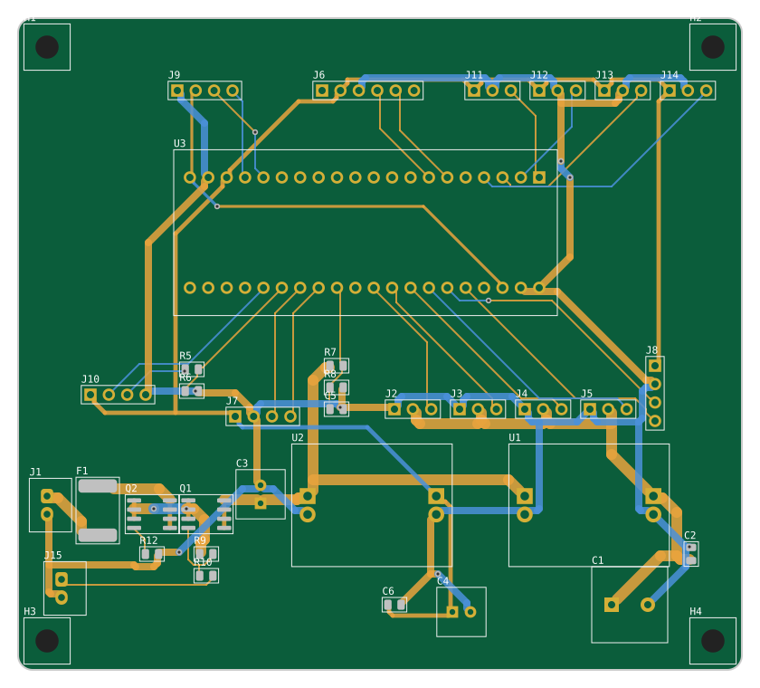

# 曼波机器狗扩展底板 V2

原项目只有飞线接法，没有任何原理图和 PCB。这块底板把 Blue Pill（STM32F103C8T6）、4 个舵机、所有模块和电源集成到一块 100 × 90 mm 的双层板上，同时解决了原接法的几个硬件问题。

> ⚠️ 这块板是用脚本生成并自动布线的，已通过脚本自带的 ERC/DRC，以及 **KiCad 8 官方 ERC/DRC（0 违规、0 未连接，CI 每次推送自动跑）**，**但还没有打样、焊接或实测过**。第一次打样建议先少量（5 片），按下面的「上电检查」一步一步来。

## 和原版接线相比修了什么

| 问题 | 原接法 | V2 底板 |
|---|---|---|
| 舵机一起动 MCU 就复位 | 舵机和逻辑共用一路 5 V | 舵机和逻辑**各用一个降压模块**，舵机轨加 1000 µF |
| HC-SR04 Echo 5 V 接 PA1 | PA1 **不耐 5 V**，长期可能损坏芯片 | 1k/2k 分压到 3.33 V |
| 红外占用 PA11/PA12 | 这是 USB D-/D+，Blue Pill 板载上拉会干扰读数 | 改到 PB12–PB15（耐 5 V） |
| 没有电池电压检测 | ADC 引脚全被占用 | VBAT 经 100k/33k 分压接 PA4，低电提醒 + 自动趴下 |
| 电池接反直接烧 | 无保护 | Q2 P-MOS 防反接 + 3 A 自恢复保险丝 |
| 开关承受全部电流 | 小拨动开关只能过 0.5 A | 开关只控制 Q1 栅极，大电流走 MOS 管 |

## 文件

| 路径 | 内容 |
|---|---|
| `fab/manbo-carrier-gerbers.zip` | **直接上传到嘉立创/JLCPCB 等下单** |
| `kicad/manbo-carrier.kicad_pro` | KiCad 8 工程（原理图 + PCB，可继续修改） |
| `kicad/bom.csv` | 板上元件清单（位号、封装，自动生成） |
| `采购清单.md` | **整机采购清单**（含舵机、模块、电池等） |
| `kicad/pinmap.md` | Blue Pill 每个引脚接到哪里 |
| `kicad/schematic-preview.svg` | 原理图预览（手机也能看） |
| `kicad/drc-report.txt` | 布线和 DRC 结果 |
| `gen/` | 生成脚本：**改设计请改 `gen/design.py` / `gen/layout.py`**，然后运行 `python3 hardware/gen/build.py` |

## 下单参数

层数 2，板厚 1.6 mm，尺寸 100 × 90 mm，最小线宽/间距 0.2 mm，最小孔 0.4 mm（过孔），铜厚 1 oz，阻焊颜色随意。这些都是常规工艺，打样通常最便宜那档就够。

## 焊接顺序

1. 贴片：Q1、Q2（SOIC-8，注意 1 脚圆点）、F1、电阻电容、LED（绿点/竖线 = 负极，对应丝印 1 脚）
2. 直插：排针/排母、XH 座、电解电容（**长脚 = 正极 = 方焊盘**）
3. Blue Pill 用两条 1×20 **排母**插装，方便更换
4. 降压模块：用排针立在板上，或用短线接到 IN+/IN-/OUT+/OUT- 四个大孔

## 上电检查（第一次一定要按顺序）

1. **先不插 Blue Pill、不接舵机和模块。**
2. 接电池（或 7–8 V 限流电源，限流 0.5 A），J15 接上开关并打开，电源灯亮。
3. **把两个降压模块都调到 5.0 V 再往下走**——MP1584 这类可调模块出厂电压是随机的，直接接可能把 Blue Pill 和舵机烧掉。
4. 用万用表确认：`+5V_SERVO` 和 `+5V` 都是 5.0 V，Blue Pill 排母的 3V3 脚此时为 0（Blue Pill 没插）。
5. 关电，插上 Blue Pill，开电：3V3 脚应为 3.3 V。
6. 烧录 **V2 固件**：`make V2=1`，或在 Keil 里 Options → C/C++ → Define 加上 `MANBO_BOARD_V2`。原版固件引脚不同，红外和电池检测会不工作。
7. 再依次接 OLED、舵机、蓝牙等模块。

## 注意

- **Blue Pill 的 USB 口和电池不要同时供电**：Blue Pill 的 USB 5 V 和 5V 引脚之间多数没有二极管，会互相倒灌。烧录用 SWD（ST-Link）最方便。
- OLED 有两种引脚顺序（GND-VCC 和 VCC-GND），插之前看一眼模块丝印。
- HC-05 是 6 针，HC-06 是 4 针（插在 J6 的 2–5 脚）。模块方向以丝印 `VCC GND TXD RXD` 为准。
- SYN6288 和 ASR PRO 模块的引脚顺序各家不一样，用杜邦线按丝印 `VCC GND RXD TXD` 接（RXD/TXD 是模块自己的引脚名）。
- GND 铺铜：Gerber 里已经带了铺铜。在 KiCad 里打开 PCB 后，如果要改板，先按 **B**（填充全部覆铜）再出图。
- 引脚表以常见 Blue Pill 为准（左排 PB12…3V3，右排 GND…VBAT）。个别山寨板丝印不同，焊之前用 `kicad/pinmap.md` 对照一下。
