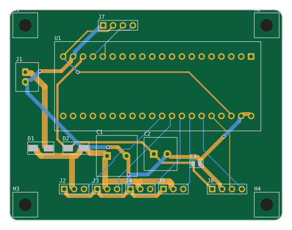

# 曼波机器狗 精简版（LITE）

**只保留"听懂口令 + 走起来"**，其余功能（屏幕、语音合成、超声波、红外、电池检测）全部去掉，换成最便宜的方案。

## 和完整版的区别

| | 完整版 V2 | 精简版 |
|---|---|---|
| 控制 | 蓝牙 + 语音识别（ASR PRO） | **语音口令（SU-03T）**，模块自带喇叭回话 |
| 屏幕 / 语音播报 / 超声波 / 红外 | 有 | 无（板载 LED 每收到一条命令闪一下） |
| 供电 | 2S 锂电 + 平衡充 + 两个降压模块 + MOS 管 | **4 节 5 号电池盒（带开关）** + 两个二极管 |
| 底板 | 100 × 90 mm，34 个元件 | **70 × 54 mm，12 个元件** |
| 固件 | `make` / `make V2=1` | **`make LITE=1`**（Keil 里加 `MANBO_LITE`） |

## 电源为什么这样设计

- **D1 SS34**：防电池接反；同时把新碱性电池的 6.4 V 降到约 6 V，不超过 SG90 的 6 V 上限。
- **D2 M7（1N4007）**：给 Blue Pill 和语音模块单独供电，再降约 0.8 V，让新碱性电池也不超过 SU-03T 的 5.5 V 上限。
- **C2 470 µF**：舵机启动时电池电压会被拉低，D2 + C2 让单片机和语音模块撑过这一下，不会复位。
- **电池**：碱性和镍氢充电电池都能用。镍氢（1.2 V × 4）更耐用；电池快没电时语音模块会先停止响应，这就是该换电池的信号。

## 文件

| 路径 | 内容 |
|---|---|
| `fab/manbo-lite-gerbers.zip` | 直接上传嘉立创下单 |
| `kicad/` | KiCad 8 工程、BOM、引脚表、预览图 |
| [采购清单.md](采购清单.md) | 整机要买的东西 |
| [../../docs/su03t.md](../../docs/su03t.md) | **SU-03T 口令配置表（必看）** |

## 组装和上电

1. 焊 D1、D2（注意二极管有竖线的一端 = 负极，对准丝印竖线）、C3，再焊排针排母、电解电容（长脚正极 = 方焊盘）。
2. **先不插 Blue Pill**，装电池打开开关，量 Blue Pill 排母的 5V 脚：应该在 3.6–5.5 V 之间。
3. 插 Blue Pill，烧录 `make LITE=1` 编出的固件（或 GitHub Actions 里 `manbo-firmware-lite` 的 `.hex`）。
4. 按 [docs/su03t.md](../../docs/su03t.md) 配置好 SU-03T，插到 J6，再接舵机。
5. 说"小呆小呆，前进"。说"停"立即停；没听清的话 10 秒后也会自己停。

> 不想打板：这块板电路很简单，用一块洞洞板（约 1 元）照着 `kicad/pinmap.md` 飞线也完全可以。
